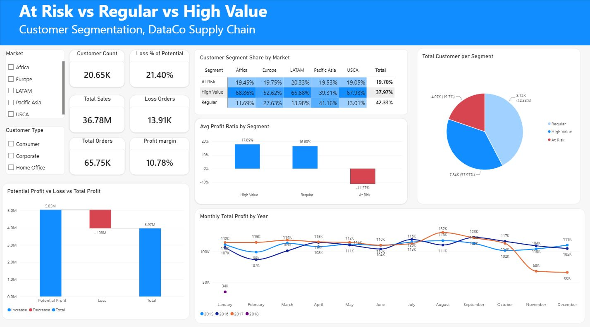
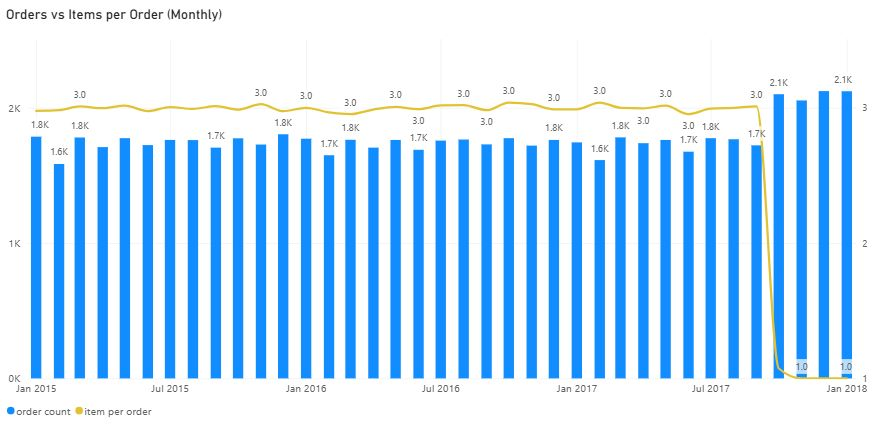
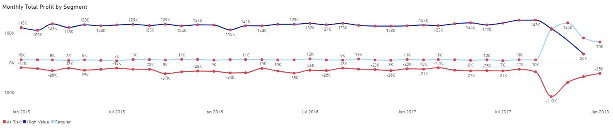

# Customer Segmentation for Profitability: DataCo Supply Chain

Segmenting 20,652 customers of a global supply chain company (180,519 order lines, USD 36.78M in sales) into **At Risk**, **Regular**, and **High Value** groups with a modified RFM model, to find out which customers cost the company money and why. Cleaning and segmentation were done in Python (Google Colab), and the analysis was presented in a two-page Power BI dashboard, as the final project of a Data Analyst bootcamp.



## Business Problem

Almost 1 in 5 customers is unprofitable in total. **4,069 of 20,652 customers (19.7%) have a negative total profit**, costing the company **USD 1.08M**, or **21.4% of its USD 5.05M potential profit**.

Questions:
1. Who are the loss-making customers, and how do they differ from profitable ones?
2. What drives the loss: discount, product, market, shipping, or something else?
3. What should the business do about it?

## Dataset

| Item | Detail |
|---|---|
| Source | [DataCo Smart Supply Chain for Big Data Analysis (Kaggle)](https://www.kaggle.com/datasets/shashwatwork/dataco-smart-supply-chain-for-big-data-analysis) |
| Period | January 2015 to January 2018 |
| Size | 180,519 order lines, 65,752 orders, 20,652 customers |
| Total sales / profit | USD 36.78M / USD 3.97M (margin 10.78%) |
| Markets | Africa, Europe, LATAM, Pacific Asia, USCA |

The raw file is not included (download it from Kaggle). The processed files are in `data/`.

## Methodology

**1. Data cleaning (Python).**
- Dropped sensitive or unused columns: Customer Email, Customer Password, Latitude, Longitude, Product Image, Order Zipcode, Product Description.
- Combined first and last name into `Customer name`; converted order and shipping dates to datetime; added Order Year, Month, Day, and Hour.
- No duplicate rows were found.
- In Power BI, four more irrelevant columns were removed (Customer Street, Customer Zipcode, Order Item Cardprod Id, Product Status) and missing customer names were filled with "Unknown", leaving 46 columns.

**2. Customer aggregation.** One row per customer with Frequency (distinct orders), Total Sales, and Total Profit.

**3. Scoring.** Each dimension gets a score from 1 to 3.

| Score | Frequency (orders) | Sales | Profit |
|---|---|---|---|
| 1 (Low) | 1 | bottom third | bottom third |
| 2 (Medium) | 2-6 | middle third | middle third |
| 3 (High) | 7-15 | top third | top third |

Frequency uses manual bins because the distribution is clustered (43% of customers have only one order). Sales and Profit use tertiles (`pd.qcut`).

`Total_Score = Frequency x 20 + Sales x 35 + Profit x 45`

**4. Segmentation.**
- **At Risk**: total profit < 0.
- **Regular** and **High Value**: customers with profit >= 0, split at the median Total_Score.

A first version split all customers by Total_Score alone. It only caught **41.6%** of loss-making customers as At Risk, because high sales scores offset low profit scores. At Risk was therefore defined directly from profit.

**Why not classic RFM?** Recency is distorted in this dataset: from October 2017 the data structure changes (see below) and the 40% most recently active customers are all new single-order customers. Monetary (sales) also cannot separate loss-making customers, since in a standard RFM test about 41% of At Risk customers scored 4-5 (of 5) on Monetary.

## Results

| Segment | Customers | % Customers | Median orders | % Sales | Total profit |
|---|---|---|---|---|---|
| High Value | 7,841 | 38.0% | 5 | 68.4% | +USD 4.32M |
| Regular | 8,742 | 42.3% | 1 | 12.3% | +USD 0.72M |
| At Risk | 4,069 | 19.7% | 3 | 19.3% | -USD 1.08M |

### Key findings

1. **At Risk customers shop exactly like High Value customers.** Average discount 10.16% vs 10.16%, sales per order line USD 203 vs USD 204, quantity per line 2.14 vs 2.18. The only difference is the outcome: 36% of At Risk order lines lose money, vs 15% for High Value.
2. **No variable in the dataset explains the loss.** About 19% of order lines lose money in every market, shipping mode, payment type, and department. Identical transactions (same product, price, discount, and quantity) range from +50% to -275% profit ratio; product, price, discount, and quantity together explain only 3.4% of the variation in profit.
3. **No product is structurally unprofitable.** Only 3 of 118 products have negative total profit, all with 15 or fewer transactions. Every product with 100+ transactions has a positive margin (4.6% to 15%), and At Risk customers buy the same product mix as High Value customers.
4. **Losses are concentrated in a few expensive best-sellers.** 10% of the largest loss lines account for 39% of At Risk losses, and 5 products (all among the 6 best-sellers) account for 62% of At Risk gross loss. More expensive products lose more per loss line (e.g. gun safe -USD 227 vs football cleat -USD 74).
5. **The late-2017 profit drop is a data structure change, not a performance drop.** From October 2017: 18 new product categories, items per order fall from 3.0 to 1.0, and the data covers only 2 of 5 markets, 7 of 23 regions, and 40 of 164 countries. Orders stay at about 2,000 per month and the margin is unchanged (10.76% vs 11.08%).



6. **Segment shifts after October 2017 are a composition effect.** About 2,000 new single-order customers arrive each month and fall into Regular or At Risk: 74% of Regular and 38% of At Risk customers are new-structure customers, vs 3.5% of High Value.



**Robustness check.** `Order Status` in this dataset follows the payment method (for example, CASH is always CLOSED and COMPLETE only appears for DEBIT), and only CANCELED and SUSPECTED_FRAUD orders were never shipped (4.3% of lines). Excluding them gives the same result: 19.7% loss-making customers and a loss of USD 1.05M.

## Recommendations

Because losses cannot be predicted from customer profile, the actions focus on transactions and data rather than on penalizing At Risk customers.

| Horizon | Action | KPI |
|---|---|---|
| Short term (0-1 month) | Record cost data per transaction: cost of goods, actual shipping cost, returns, refunds, cancellation cost; flag canceled and fraud orders so they are not counted | % of transactions with complete cost data |
| Short term (0-1 month) | Monthly review of the largest loss transactions, starting with the top 10% (39% of At Risk losses) and the 5 products behind 62% of the gross loss | Loss % of Potential (currently 21.4%) |
| Medium term (1-3 months) | Second-purchase program: follow-up and product recommendations 7-14 days after delivery, validated with an A/B test | % of customers with 2+ orders (currently 57%) |
| Medium term (1-3 months) | High Value retention: loyalty tier, priority shipping, personal communication (protects 68% of sales) | High Value retention rate |
| Long term (3-12 months) | Re-evaluate product pricing with true per-product margin from the new cost data | % of products with negative margin |
| Long term (3-12 months) | Evaluate the new categories and markets once the post-October 2017 data reaches 12 months | Margin and repeat rate per new category/market |
| Long term (3-12 months) | Re-run the segmentation using cost-based profit | Root causes of loss identified |

## Limitations

- The dataset has no cost, return, or refund data, so the cause of loss-making transactions cannot be confirmed.
- The near-random profit pattern and mismatched product categories (e.g. a gun safe listed under *Fishing*) suggest the data is synthetic.
- Data after October 2017 covers only about 4 months and is not comparable with the earlier 33 months.

## Repository Structure

```
.
├── README.md
├── data/
│   ├── customer_segmentation_summary.csv      # one row per customer, scores and segment
│   └── dataco_order_level_with_segment.zip    # order-line data with Final_Segment (zipped CSV)
├── notebooks/
│   ├── 01_data_understanding.ipynb            # data understanding and cleaning
│   └── 02_customer_segmentation.ipynb         # cleaning, aggregation, scoring, segmentation
├── dashboard/
│   └── DataCo_Customer_Segmentation.pbix      # Power BI dashboard (Overview, Trend & Anomaly)
├── presentation/
│   └── DataCo_Customer_Segmentation_Presentation.pdf
└── images/
    ├── dashboard_overview.png
    ├── orders_vs_items_per_order.png
    └── monthly_profit_by_segment.png
```

## How to Open

1. **Notebooks**: open in Jupyter or Google Colab. Place `DataCoSupplyChainDataset.csv` from Kaggle in the same folder (read with `encoding='latin1'`).
2. **Dashboard**: unzip `data/dataco_order_level_with_segment.zip`, open `dashboard/DataCo_Customer_Segmentation.pbix` in Power BI Desktop (free), and if the source path breaks, point it to the unzipped CSV under *Transform data > Data source settings*.

## Tools

Python (pandas, NumPy; Google Colab) and Power BI (Power Query, DAX measures, two-page interactive dashboard).

## Author

**Vino Jayrasta Samudra**: Data Analyst (bootcamp graduate), based in Surabaya, Indonesia.
